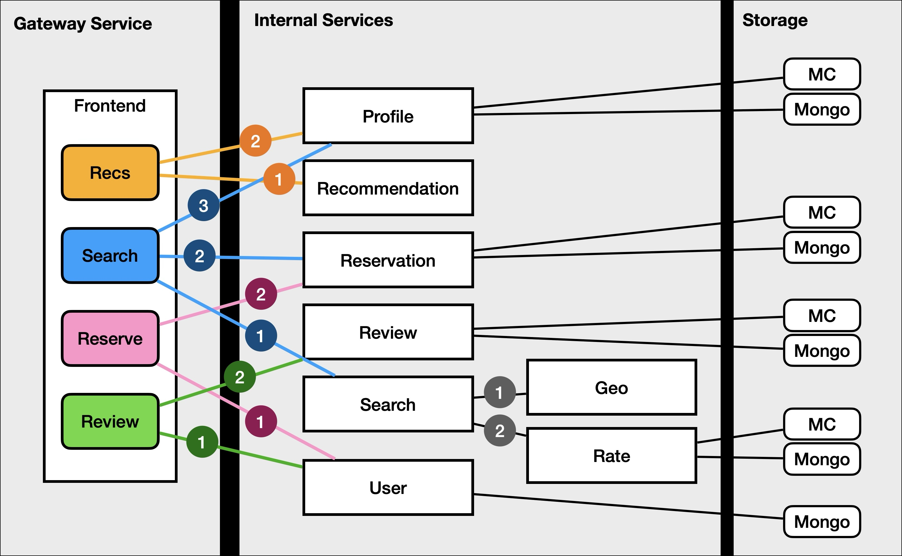

# hotel on rpcstack

The DeathStarBench **hotel reservation** microservice benchmark, written in Rust
on [rpcstack](https://github.com/rpcstack/rpcstack): Tonic gRPC services whose
generated stubs run an rpcstack policy stack. Three policy modes are built from
the same source: `baseline` (no policy), `masa` (the Masa composed policy) and
`policy` (the RPC policy of the editable [`policy/`](policy/README.md)
directory, which starts out equal to `masa`). The frontend serves its public API
over HTTP/JSON, matching DeathStarBench's Go hotel frontend, as well as gRPC.



Each rectangular box is a microservice. Coloured rounded boxes on the frontend
are its public APIs; edge numbers give the order in which a parent calls its
children. Services with a cache check Redis first, fall back to MongoDB, and
fill the cache from MongoDB ("MC" in the figure; this port uses Redis).

| Service | Port | Backends | Called by |
| --- | --- | --- | --- |
| frontend | 8660 (gRPC), 5000 (HTTP/JSON) | | load generator, HTTP clients |
| search | 8668 | | frontend |
| geo | 8661 | in-memory k-d tree | search |
| rate | 8663 | rate-mongo, rate-redis | search |
| profile | 8662 | profile-mongo, profile-redis | frontend |
| reservation | 8666 | reservation-mongo, reservation-redis | frontend |
| user | 8669 | user-mongo | frontend |
| recommendation | 8664 | in-memory | (standalone) |
| review | 8667 | review-mongo, review-redis | (standalone; frontend's review API is a stub) |

The load generator (`hotel_client_bench`) sends `Search` and `Reservation`
requests at a fixed rate over gRPC, each carrying a Masa root context with its
SLO, and writes one CSV row per request.

## HTTP API

The frontend also serves the same routes, parameters, status codes and JSON
shapes as the HTTP frontend of DeathStarBench's Go hotel reservation
(`hotelReservation/services/frontend`), on port 5000, so one HTTP load generator
can drive both applications. Every request enters the RPC stack like a
`hotel_client_bench` request: the frontend creates its Masa root context
(API name, deadline = now + SLO) and calls the frontend service in process, so
client hooks, the frontend's server hooks and its child RPCs run as for a gRPC
client. The per-route SLO is application config, `frontend.sloMs` in
`config/hotel.json` (not part of `policy/`); all default to 200 ms, what
`config/gen_config.json` gives the gRPC generator for both `Search` and
`Reservation`.

| Route | Parameters | 200 response | Errors |
| --- | --- | --- | --- |
| `GET /hotels` | `inDate`, `outDate` (YYYY-MM-DD), `lat`, `lon`, optional `locale` | GeoJSON `FeatureCollection` of the nearby hotels available in the dates | 400 missing or malformed parameter |
| `GET /recommendations` | `require` = `dis`, `rate` or `price`; `lat`, `lon`; optional `locale` | GeoJSON `FeatureCollection` | 400 |
| `GET /user` | `username`, `password` | `{"message": "Login successfully!"}` or `{"message": "Failed. Please check your username and password. "}` | 400 |
| `GET /reservation` | `inDate`, `outDate`, `hotelId`, `customerName`, `username`, `password`, optional `number` (rooms) | `{"message": "Reserve successfully!"}`, `"Failed. Already reserved. "` or the login failure message | 400 |
| `GET /rates` | `hotelId` | `{"hotelId": ..., "ratePlans": [{"code","inDate","outDate","roomType": {"code","roomDescription","bookableRate","totalRate","totalRateInclusive"}}]}` | 400 |
| `POST /admin/{rate,profile,capacity,hotel}` | | | 501 (not supported, below); 405 for other methods |
| `/review`, `/restaurants`, `/museums`, `/cinema` | | | 501 |

A feature of the GeoJSON is `{"type":"Feature","id":<hotel id>,"properties":{"name","phone_number"},"geometry":{"type":"Point","coordinates":[lon,lat]}}`
with float32 coordinates, as Go encodes them. A request the policy rejects or
aborts (`/EarlyReturn`, admission) answers 504 (deadline exceeded) or 503;
other downstream failures 500.

Where it differs from the Go frontend (the services behind it are the Rust
port's, not the vibesys-modified Go ones):

* **Owner writes are not supported** and answer 501 rather than being faked:
  the Rust services have no write RPCs (no rate/profile/capacity update, no
  hotel addition). `/review`, `/restaurants`, `/museums` and `/cinema` answer
  501 too (the review API is a frontend stub; there is no attractions service).
* **`/user` is not a password check.** The user service looks the username up
  and reports success with probability `probCheckUser` (80 %); the password is
  ignored. `Username_i` / `Password_i` are seeded for `i < users`.
* **`/reservation`** runs the user check first and, unlike Go (which reserves
  regardless and only words the message differently), skips the reservation
  when it fails. A missing or zero `number` books one room (Go: zero rooms).
  Dates must be real days (Go checks the format only; the reservation service
  panics on a bad date).
* **`/hotels`** also validates its dates (400), where Go forwards any text.
* **Data differs:** the services seed their own fixed data (80 hotels, ids
  `"1"`..`"80"`, 2015 rate plans, in-memory geo and recommendation indexes)
  instead of the Go task's dataset, so the Go task's correctness oracle, which
  checks answers against that dataset and the writes made so far, cannot pass;
  a load generator drawing hotels and locations from that dataset gets valid
  responses with empty or different results where the data does not overlap.
* **`/rates`** returns the hotel's plans from the rate service (which, on a
  cache miss, returns its whole inventory; the frontend keeps only the
  requested hotel's) and takes no dates, like Go.
* Responses are `Content-Type: application/json` (Go leaves net/http's sniffed
  `text/plain`); error bodies are plain text, as Go's `http.Error`.

The gRPC frontend (`HandleSearch`, `HandleReservation`, ...) is unchanged for
`hotel_client_bench`; the proto gained `HandleUser`, `HandleRecommendation` and
`HandleRates` for the HTTP routes. `docker run --rm rpcstack-hotel:<mode> http-check --http http://frontend:5000`
(`hotel_http_check`) validates every route's status and shape.

## Deploy in one command

Layout: `k8s/base` plus `k8s/overlays/<mode>` (kustomize).

```sh
MODE=masa docker compose up --build                       # Compose (omit MODE for baseline; or policy)
scripts/kind-up.sh && scripts/k8s-deploy.sh masa          # Kubernetes (or: baseline, policy)
```

## Quick start: Docker Compose

Requires Docker with Compose v2. Images are built locally; nothing is pulled
except `rust`, `debian`, `mongo:7.0` and `redis:7.2`.

```sh
docker compose up --build                 # baseline
MODE=masa docker compose up --build       # Masa policy
MODE=policy docker compose up --build     # the policy/ directory's policy
```

This builds one image (`rpcstack-hotel:<mode>`, all binaries), starts the 9
MongoDB/Redis containers, the 9 hotel services and the load generator. The load
generator runs `config/gen_config.json` (100 rps for 30 s after 5 s warm-up),
prints per-second counters, dumps its traces between `---BEGIN TRACES---` and
`---END TRACES---`, and exits; the services keep running. Run it again with
`docker compose run --rm client-bench`. The frontend is published on
`localhost:${FRONTEND_PORT:-8660}` (gRPC) and `localhost:${FRONTEND_HTTP_PORT:-5000}`
(HTTP); try `curl 'localhost:5000/hotels?inDate=2015-04-09&outDate=2015-04-10&lat=37.7867&lon=-122.4112'`.
Stop with `docker compose down -v`.

The first build compiles the pinned nightly toolchain's dependencies and takes
several minutes. The Dockerfile builds dependencies in a separate
[cargo-chef](https://github.com/LukeMathWalker/cargo-chef) layer, so later
builds (and edits to the hotel sources) reuse it; CI persists that layer in the
GitHub Actions cache.

## Quick start: Kubernetes (kind)

Requires Docker, [kind](https://kind.sigs.k8s.io/) and kubectl.

```sh
scripts/kind-up.sh                 # kind cluster "rpcstack-hotel" + registry:2 on localhost:5001
scripts/k8s-deploy.sh masa         # build, push to the local registry, kubectl apply
kubectl -n rpcstack-hotel get pods
scripts/k8s-teardown.sh --cluster  # delete namespace, cluster and registry
```

`k8s/base` holds plain manifests (a Deployment and Service per process, a
ConfigMap generated from `config/`); `k8s/overlays/<mode>` only switches the image
tag. `HOTEL_NAMESPACE` selects another namespace, `KIND_CLUSTER` the
kubectl context (`kind-$KIND_CLUSTER`) and `BUILDKIT_ADDR` builds with
`buildctl` on an existing BuildKit daemon instead of `docker build`. `k8s-deploy.sh` renders them with
`kubectl kustomize --load-restrictor LoadRestrictionsNone` because the ConfigMap
reads `config/` outside the kustomization. Set `REGISTRY_PORT` / `KIND_CLUSTER`
to avoid clashes; any cluster that can pull from `$REGISTRY` works.

## Policy modes

| Mode | Cargo features of `hotel` | Generated stub hooks |
| --- | --- | --- |
| `baseline` | `baseline` (none) | `masa::DefaultHooks` = `tonic::rpcstack::noop::NoopHooks` |
| `masa` | `sched_slo,abort_slo,signal_slack,est_mean_var,ac_pred` | `masa_policy::PolicyHooks` (Masa stack) |
| `policy` | `policy` (depends on the `hotel-policy` crate in `policy/`) | `hotel_policy::Hooks` = `PolicyHooks<hotel_policy::Stack>` |

`policy` is `masa` with both policy slots moved into one directory an
optimization agent edits: the run-queue scheduler (rpcstack's `sched_custom`
feature, with `RPCSTACK_QUEUE_SOURCE` pointing at `policy/queue/queue.rs`) and
the module stack behind the hooks (`policy/src/stack.rs`, wired through
`default_hooks_path("hotel_policy::Hooks")`). Its initial content reproduces
`masa` (same priority-heap queue, same four modules), so the first numbers
agree. See [policy/README.md](policy/README.md) for the slots, how to test a
change and the invariants a policy keeps. Build modes one at a time, with
explicit packages as `scripts/check.sh` does; `--workspace` with one mode's
feature would let `hotel-policy` enable Masa features in a `baseline` build.

The mode is chosen at build time: Cargo feature → Docker build arg `MODE` →
`MODE` env for Compose, or overlay for Kubernetes. Each individual Masa feature
(`sched_fifo`, `abort_slack`, `trace_queue_latency`, `ac_rajomon`, ...) is also
exposed by the `hotel` crate; build an image with an explicit list via
`docker build --build-arg FEATURES=sched_slo,abort_slo .` (or `FEATURES=...`
with Compose). `docker run --rm rpcstack-hotel:<mode> mode` prints what an image
was built with.

The masa preset is the one documented in rpcstack's
`examples/masa/README.md`. Scheduling is cooperative: rpcstack reorders and
rejects work between future polls; it does not preempt a running handler.

## Configuration

* `config/hotel.json`: service addresses (Compose service names, which are also
  the Kubernetes Service names), ports, data sizes, cache-miss and user-check
  probabilities. With `replicas: 1` a service is dialled by name; with
  `replicas: N > 1` Masa's client-side round robin dials `<ip>-1 .. <ip>-N`.
* `config/gen_config.json`: load generator (APIs, SLOs in µs, timeouts in ms,
  rps list, warm-up and duration, optional `ApiWeights` and `MaxInFlight`).
* `config/smoke/*.json`: the smoke test's moderate, overload and recovery runs.
* `LOG_LEVEL` / `RUST_LOG` control logging. `MASA_POLICY_PARAMS_PATH` points
  Masa at a policy-parameters file if you mount one.

## Testing

```sh
scripts/test.sh                 # cargo test, all modes (incl. hooks regression test, policy/ tests)
scripts/check.sh                # fmt, rpcstack pin, single tokio/hyper, -D warnings, all modes
scripts/smoke-compose.sh masa   # full stack under Compose (also: baseline, policy)
scripts/smoke-k8s.sh masa       # full stack on kind (also: baseline, policy)
```

The smoke scripts bring the stack up, then:

0. **HTTP API check** (`hotel_http_check`): every HTTP route answers with the
   status and JSON shape described above; the unsupported owner routes answer
   501.
1. **Policy-liveness probe** (`hotel_policy_probe`): waits for an end-to-end
   Search, sends 20 control Searches with a 5 s SLO (all must succeed), then
   sends each of the 9 services one request whose Masa context deadline has
   already expired. In `masa` and `policy` mode (the smoke treats `policy` as `masa`) every service must reject it with
   `DEADLINE_EXCEEDED "/EarlyReturn?src=<that service>…"`, produced by Masa's
   deadline guard in that service's server hooks before the handler runs. In
   `baseline` none may: the no-op hooks ignore the context and the handler
   answers. So the masa check fails on a baseline build, and on any service
   whose stubs fell back to no-op hooks. In `baseline` mode the smoke also
   runs the probe with `--expect masa` as a negative control and fails unless
   that run reports `PROBE FAIL`.
2. **Moderate load** (100 rps, 30 s, SLO 200 ms): zero transport errors and
   ≥ 99 % of requests completed.
3. **Overload burst** (masa only; 4000 rps, 10 s, SLO 20 ms): at least one
   request must be rejected or aborted with `/EarlyReturn`.
4. **Recovery** (masa only; 100 rps, 20 s): ≥ 99 % completed and zero
   transport errors over the last 5 s. Masa's predictive admission is an AIMD
   controller that reopens only as admitted requests complete, so the first
   seconds after an overload still shed load by design.
5. The probe runs again; no service log may contain a panic and no
   container/pod may restart during the run.

In `baseline` mode the same burst runs without admission control, so requests
time out (or reset) while it lasts, and a recovery run
(100 rps, 20 s) must then answer >= 99 % of both `Reservation` and `Search`
requests over its last 5 s. This is the regression check for the MongoDB wedge
described next.

### Known issue (fixed): reservation MongoDB wedge

Before the fix, after a mixed `Search` + `Reservation` overload in baseline mode
about 80 % of `Reservation` requests (the `probCheckUser` share that passes the
user check and calls `make_reservation`) hung indefinitely, while `Search`
recovered. CPU, queues, Redis and client retries were idle; restarting the
reservation service or its MongoDB cleared it, restarting its Redis did not; it
persisted for minutes. Reproduced on Compose: the post-overload recovery run
answered 196 of 999 `Reservation` requests (the rest timed out).

Counting entries to and exits from each await in `make_reservation` showed the
hang is in `insert_many`: after the burst, every new `make_reservation` entered
the insert and none ever left it, while the Redis calls kept completing and the
MongoDB server showed no running operation. The cause is cancellation: when a
client times out, the server drops the handler future, and the
`mongodb` 2.8.2 operation is abandoned mid-flight and the driver's later writes
on that client never complete (the driver-internal mechanism was not traced;
that spawning removes the hang is what the evidence shows).
Every request-path MongoDB call in every service (`user`, `profile`, `rate`,
`review`, `reservation`) therefore runs in its own spawned task
(`mongo::detached`, `crates/hotel/src/mongo.rs`), so a cancelled request only
stops waiting for the result and never abandons a driver operation. This
matters beyond `reservation`: on a 4-core GitHub runner under kind the first
version of the fix (reservation only) still failed the recovery check: every
`Reservation` request, including the ones the user check answers by itself,
timed out after the burst, which points at the `user` service's MongoDB client. After the fix the same recovery run
answers 100 % of `Reservation` and `Search` requests, and the baseline smoke
enforces this.

Results land in `out/smoke-<compose|k8s>-<mode>/`.

## Repository layout

```
Cargo.toml            workspace; pins rpcstack (git rev) and patches tokio/hyper
crates/hotel          services (frontend: gRPC + HTTP/JSON), load generator, probe, HTTP check, protos, build.rs
crates/app-utils      load-generator runtime, logging, latency stats
policy/               the editable RPC policy: run queue + module stack (policy mode)
.cargo/config.toml    RPCSTACK_QUEUE_SOURCE -> policy/queue/queue.rs
config/               runtime configuration (mounted into containers)
Dockerfile            one builder, one runtime image; docker/entrypoint.sh selects the binary
docker-compose.yaml   full stack + load generator
k8s/                  kustomize base (baseline) and the masa and policy overlays
scripts/              test/check/format, smoke, kind and deploy helpers
```

## Provenance

Ported from [vic-lsh/masa](https://github.com/vic-lsh/masa) `apps/hotel` and
`apps/app-utils` at commit `c8486eb`, itself a port of DeathStarBench's
hotelReservation. Built on rpcstack at
`de0cedc080882469b316c8125b7ad17a7c93e7fb`. Changes from the source:
dependencies trimmed to those used (the tonic-example feature set, unused
memcached pool and `app-util-macros` were dropped); `build.rs` sets
`default_hooks_path("masa::DefaultHooks")` for every proto (rpcstack stubs
otherwise default to no-op hooks); single-replica services are dialled by DNS
name; added the policy probe, Docker/Compose/Kubernetes deployment and smoke
tests. The masa experiment runner and its configs are not included. See
[TEMPLATE.md](TEMPLATE.md) for the layout other application repositories reuse.
